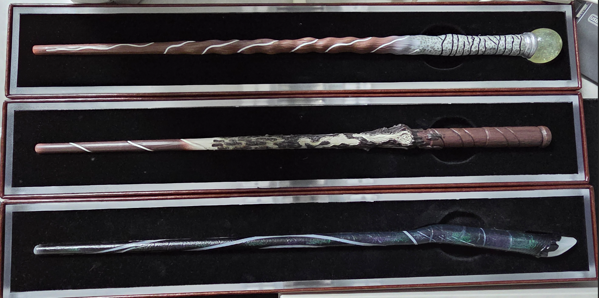
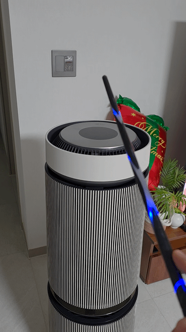
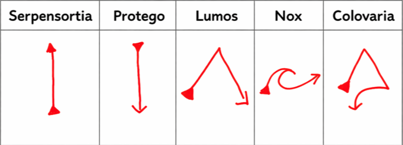
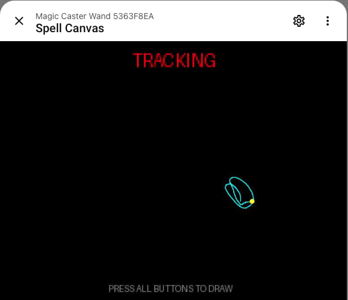

<!-- hass-standards:header:start -->
# Magic Caster Wand

**Lumos**를 시전해 방의 조명을 켜고, **Nox**로 끄세요. 해리 포터 Magic Caster Wand와 보관함을 Bluetooth로 Home Assistant에 연결하는 HACS 커스텀 통합입니다. 주문과 버튼으로 자동화를 실행하고, HA에서 지팡이로 LED·진동 효과를 보낼 수 있습니다.

[English](README.md) | **한국어**

<!-- hass-standards:badges:start -->
[](https://github.com/eigger/hass-magic-caster-wand/releases)
[](#설치)
[](hacs.json)
[](https://github.com/eigger/hass-magic-caster-wand/actions/workflows/tests.yml)
[](https://github.com/eigger/hass-magic-caster-wand/actions/workflows/validate.yml)
[](LICENSE)
[](https://github.com/eigger/hass-magic-caster-wand/releases)
<!-- hass-standards:badges:end -->
<!-- hass-standards:header:end -->



<table>
  <tr>
    <td align="center"><br/><b>주문으로 기기 제어</b></td>
    <td align="center"><br/><b>지팡이로 조명 켜기</b></td>
  </tr>
</table>

## 무엇을 할 수 있나요?

**지팡이 연결 → 내장 제스처 시전 → Spell 센서에 주문 이름 표시 → 자동화로 조명이나 다른 HA 기기 제어.** 기본 주문은 지팡이 자체에서 인식해 알려 주므로, 이 흐름에는 **TFLite 서버나 모델이 필요하지 않습니다.**

| 기능 | Home Assistant에서 사용하는 방법 |
|---|---|
| 주문 자동화 | **Spell** 센서에 `Lumos`, `Nox` 등의 이름이 표시됩니다. 이 값을 조건으로 원하는 액션을 실행합니다. |
| 버튼·기기 상태 | 지팡이 버튼의 바이너리 센서로 다른 트리거를 만들고 배터리 센서로 상태를 확인합니다. |
| 지팡이 효과 | 미리 정의된 효과 재생, LED 색상 변경·끄기, 진동, 사용자 매크로 전송을 지원합니다. |
| 선택 기능: 움직임 추적 | **Spell Tracking**으로 IMU 데이터를 받아 **Spell Canvas**와 서버 기반 인식에 사용합니다. 아래의 별도 준비가 필요합니다. |
| Magic Caster Box | 뚜껑·USB·지팡이 유무, 배터리와 연결 상태를 확인하고 단일 `TIP` LED를 제어합니다. 진동 모터나 지팡이 IMU는 없습니다. 지팡이와 별도로 추가합니다. |

## 지원 기기와 최소 요구사항

- 지팡이 모델: **Defiant, Loyal, Honourable**. Magic Caster Box도 지원합니다.
- Home Assistant **2025.4.0 이상**, HACS 또는 수동 설치, 연결 가능한 Bluetooth 어댑터 또는 ESPHome Bluetooth proxy가 필요합니다.
- 기기를 충전하고 깨운 뒤 Bluetooth 범위 안에 둡니다. 다른 앱이 연결을 점유하면 종료하세요. 프록시의 GATT 연결에는 `bluetooth_proxy.active: true`가 필요하며, active 스캔은 별도 설정입니다. [Bluetooth 프록시 설정](https://github.com/eigger/blesession/blob/main/docs/bluetooth.ko.md)을 참고하세요.

## 설치

<!-- hass-standards:installation:start -->
[](https://my.home-assistant.io/redirect/hacs_repository/?owner=eigger&repository=hass-magic-caster-wand)
<!-- hass-standards:installation:end -->

1. HACS에서 **Magic Caster Wand**를 검색해 다운로드하거나 위 버튼을 누릅니다. HACS 기본 저장소 목록에 등록되어 있습니다. 수동 설치 시 `custom_components/magic_caster_wand` 폴더만 HA 설정 폴더의 `custom_components` 안에 복사합니다.
2. Home Assistant를 재시작합니다. **설정 → 기기 및 서비스 → 통합 구성요소 추가 → Magic Caster Wand**를 선택하거나 Bluetooth 발견 알림을 확인합니다.
3. 깨어 있는 지팡이 또는 보관함을 선택합니다. 기기 페이지에서 **Connect** 스위치를 켠 뒤 주문을 받거나 효과를 보내세요. Bluetooth 광고 발견만으로 실제 연결이 확인된 것은 아닙니다.

처음에는 **Spell Tracking을 끈 상태**로 **Connected**가 켜졌는지 확인하고, 평소 시전할 때처럼 지팡이를 잡아 아래의 내장 제스처를 시도하세요. **Spell** 엔티티에서 주문 이름이 바뀌는지 확인한 뒤 자동화를 만듭니다. 반응이 없다면 연결과 버튼 상태부터 확인하세요. 연결이 끊겨도 마지막 주문이 표시될 수 있으므로, 이전 주문 값만으로 현재 연결을 판단하지 마세요.

## 내장 제스처부터 시도하기

아래는 지팡이 내장 주문 참고 그림과 시작하기 좋은 두 제스처입니다. 화살표와 지팡이의 기본 시전 방법을 따라 움직이세요.



<table>
  <tr>
    <td align="center"><b>Lumos</b><br/></td>
    <td align="center"><b>Nox</b><br/></td>
  </tr>
</table>

나머지 참고 그림은 [전체 제스처 목록(영어)](docs/user-guide.md#spell-gestures)에서 볼 수 있습니다. 그림이 있다고 해서 모든 제스처를 지팡이 내장 펌웨어 또는 사용 가능한 외부 모델이 인식한다는 뜻은 아닙니다.

## Lumos로 조명 켜고 Nox로 끄기

Home Assistant에서 자동화를 만들고 다음 YAML을 사용하세요. `sensor.mcw_example_spell`이 나오는 곳을 **모두** 실제 Spell 엔티티 ID로 바꾸고, 조명 ID도 변경합니다. 지팡이 기기 페이지에서 실제 엔티티 ID를 확인할 수 있습니다. 조명 액션 대신 다른 HA 기기의 액션을 넣어도 됩니다.

```yaml
alias: Wand — Lumos and Nox
triggers:
  - trigger: state
    entity_id: sensor.mcw_example_spell
    attribute: last_updated
actions:
  - choose:
      - conditions: "{{ trigger.to_state.state | lower == 'lumos' }}"
        sequence:
          - action: light.turn_on
            target:
              entity_id: light.example
      - conditions: "{{ trigger.to_state.state | lower == 'nox' }}"
        sequence:
          - action: light.turn_off
            target:
              entity_id: light.example
mode: single
```

조건에서 주문 이름을 소문자로 바꾸므로 `Lumos`와 `lumos` 모두 처리합니다. **`last_updated` 속성**으로 트리거하므로 주문 이름이 그대로여도 Lumos를 다시 시전하면 자동화를 다시 실행할 수 있습니다. 통합 옵션의 **Spell Timeout**은 지정한 초가 지나면 주문을 `awaiting`으로 되돌립니다. 기본값 `0`은 다음 업데이트까지 마지막 주문을 유지합니다. 위 예제는 Lumos·Nox에만 반응하므로 `awaiting`은 무시합니다.

## HA에서 지팡이로 효과 보내기

**개발자 도구 → 액션**이나 자동화에서 다음 액션을 호출하세요. 대상에는 제어할 지팡이 또는 보관함에 속한 엔티티를 지정합니다.

| 액션 | 용도 |
|---|---|
| `magic_caster_wand.play_spell` | `lumos`, `incendio` 같은 LED·진동 효과 재생. 효과를 재생하는 기능이며, 자동화에 주문 시전을 입력하는 기능은 아닙니다. |
| `magic_caster_wand.set_led` | `group`, `rgb_color`, 선택적인 `duration`으로 지팡이 LED 그룹 제어. |
| `magic_caster_wand.clear_leds` | LED 끄기. |
| `magic_caster_wand.vibrate` | 지팡이 진동. 단일 명령은 요청한 시간과 관계없이 약 **800ms** 진동합니다. |
| `magic_caster_wand.send_macro` | LED 변경·대기·진동·반복을 사용자 매크로로 조합. |

예를 들어 지팡이에서 Lumos 효과를 재생하려면 다음을 실행합니다. 대상 엔티티는 실제 값으로 바꾸세요.

```yaml
action: magic_caster_wand.play_spell
target:
  entity_id: sensor.mcw_example_spell
data:
  spell: lumos
```

보관함은 `TIP` LED 그룹 하나만 있으며 진동 매크로 명령을 무시합니다. 자세한 설명은 [액션 안내(영어)](docs/user-guide.md#available-services)를 참고하세요.

## Spell Canvas와 선택적인 서버 인식

**Spell Canvas**는 주문을 그린 경로와 그리기 상태, 인식된 주문을 보여 주는 카메라 엔티티입니다. 지팡이가 직접 보고하는 내장 주문과 별도로 준비하는 선택 기능입니다.



1. 호환 [hass-tflite 서버](https://github.com/ificator/hass-tflite)를 준비하고 웹 UI에서 호환 `model.tflite`를 불러옵니다. 통합 옵션의 **TFLite Server URL**에 HA에서 접근할 수 있는 주소를 입력합니다. **이 프로젝트는 해당 모델을 공개 제공하지 않습니다.**
2. 지팡이를 연결하고 **Spell Tracking**을 켭니다. 현재 구현은 원격 인식기 초기화 후 IMU 스트리밍을 시작하므로, 서버나 모델이 없거나 접근할 수 없으면 추적을 켤 수 없을 수 있습니다. 모델 없이 그리기만 되는 대체 동작을 보장하지 않습니다.
3. 지팡이의 **Spell Canvas** 카메라를 엽니다. 대시보드에 표시하려면 대시보드 편집에서 **Picture entity(사진 엔티티)** 카드를 추가하고 해당 카메라를 선택하세요.
4. **지팡이의 버튼·터치 센서 4개를 모두 누른 채** 움직여 경로를 그립니다. 모두 누르고 있으면 **TRACKING**으로 표시됩니다. 하나라도 놓으면 그리기를 마치고 인식을 요청하며 **READY**로 돌아갑니다. 인식에 성공하면 자동화에서 사용하는 같은 Spell 센서가 갱신됩니다.
5. 경로가 나타나지 않으면 실제 **Spell Tracking** 스위치와 카메라 상태를 확인하세요. **SERVER OK**는 초기화 때 서버 확인에 성공했다는 표시이며 모든 제스처의 인식 성공을 뜻하지 않습니다. 재연결 후에도 추적 상태를 확인하세요.


[서버 화면과 기존 Spell Canvas 안내(영어)](docs/user-guide.md#spell-canvas)도 계속 볼 수 있습니다. 외부 모델이 없다면 내장 주문을 활용하는 자동화부터 시작하세요.

## 연결 도움말과 문서

Bluetooth 발견, 연결, 명령 실행 성공은 각각 다른 단계입니다. 연결이 끊기면 지팡이를 깨우고 **Connect**를 다시 켜세요. 프록시 연결 슬롯·거리·다른 앱의 연결도 확인합니다. 기기·펌웨어 조합에 따라 동작이 다를 수 있습니다. [문제 해결 및 진단 엔티티](docs/troubleshooting.ko.md)를 참고하세요.

- [설정·옵션·연결 상세(영어)](docs/setup.md)
- [전체 제스처·미디어·Spell Canvas·액션 안내(영어)](docs/user-guide.md)
- [개발·테스트(영어)](CONTRIBUTING.md)
- [공통 규칙 및 검증 기록(한국어)](STANDARDS.md)

Downloads 배지는 현재 GitHub 릴리스의 첨부 asset 다운로드 합계이며 활성 설치 수가 아닙니다.

<!-- hass-standards:support:start -->
## 지원

- [Issues](https://github.com/eigger/hass-magic-caster-wand/issues): 버그를 신고하거나 기능을 요청하세요.
- [Discussions](https://github.com/eigger/hass-magic-caster-wand/discussions): 질문하고 사용 경험을 공유하세요.
<!-- hass-standards:support:end -->

<!-- hass-standards:related-projects:start -->
<!-- hass-standards:related-projects:end -->

<!-- hass-standards:license:start -->
## 라이선스

[MIT License](LICENSE) 라이선스로 배포됩니다.
<!-- hass-standards:license:end -->
