# Using the wand and box

[English README](../README.md) | [한국어 README](../README.ko.md) | [Setup and options](setup.md)

## From a gesture to a Home Assistant action

1. Add the wand and turn its **Connect** switch on. Wait for its connection state to turn on.
2. Perform a built-in gesture using the wand's normal casting controls. The wand recognizes the gesture and sends its spell name over Bluetooth.
3. The wand's **Spell** sensor receives that name. In **Developer tools → States**, find the sensor belonging to your wand and watch its state and `last_updated` attribute.
4. An automation can match that spell and turn a light on, start a scene, or control another HA device. The integration does not automatically associate `Lumos` with your lights; create that association in an automation.

The built-in path needs neither a TFLite server nor **Spell Tracking**. Begin here before setting up server recognition. The **Spell** sensor keeps its last value when disconnected; check **Connected** to confirm a live connection.

| What you want to do | What to use | What happens |
|---|---|---|
| Control a light by casting a built-in spell | Connect + Spell sensor + your automation | The wand reports a recognized spell; HA runs the chosen action. |
| Use the grip/button sensors as controls | Button 1–4 binary sensors | Each sensor reports pressed/released; use it as an automation trigger. |
| Light or vibrate the wand from HA | The custom actions below | HA sends an LED/vibration effect to the connected wand. |
| See the drawn path and use server recognition | Connect + working TFLite server/model + Spell Tracking + Spell Canvas | HA receives IMU samples while tracking is active, draws a held cast and submits it to the server when released. |
| Monitor or light the box | Add the box separately | Monitor lid/USB/wand presence and control its single TIP LED. The box does not provide wand motion or vibration. |

## Built-in spell gestures

This is the original built-in gesture reference. Use the wand's own controls and watch the Spell sensor to check the name actually reported by your firmware.


## Spell gestures

These drawings are a movement reference, not a guarantee that every gesture is recognized by the wand firmware or an unavailable external model. The names reported by the wand and server can differ in case or formatting. Use the actual Spell sensor value in your automation.

<table>
  <tr>
    <td align="center"><b>Aberto</b><br/></td>
    <td align="center"><b>Accio</b><br/></td>
    <td align="center"><b>Aguamenti</b><br/></td>
    <td align="center"><b>Alohomora</b><br/></td>
  </tr>
  <tr>
    <td align="center"><b>Anteoculatia</b><br/>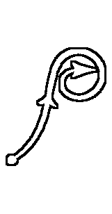</td>
    <td align="center"><b>Appare Vestigium</b><br/></td>
    <td align="center"><b>Arania Exumai</b><br/>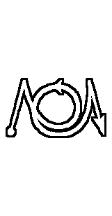</td>
    <td align="center"><b>Ascendio</b><br/></td>
  </tr>
  <tr>
    <td align="center"><b>Bombarda</b><br/>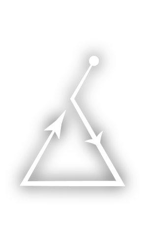</td>
    <td align="center"><b>Brachiabindo</b><br/></td>
    <td align="center"><b>Calvorio</b><br/>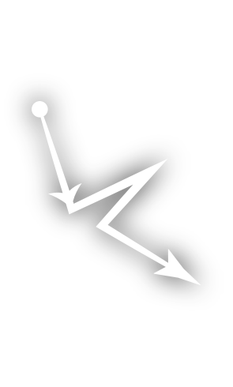</td>
    <td align="center"><b>Cantis</b><br/>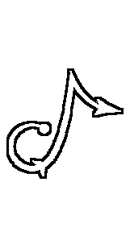</td>
  </tr>
  <tr>
    <td align="center"><b>Colloportus</b><br/></td>
    <td align="center"><b>Colloshoo</b><br/>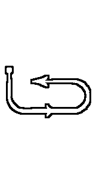</td>
    <td align="center"><b>Colovaria</b><br/></td>
    <td align="center"><b>Confringo</b><br/>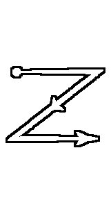</td>
  </tr>
  <tr>
    <td align="center"><b>Confundo</b><br/></td>
    <td align="center"><b>Densaugeo</b><br/></td>
    <td align="center"><b>Entomorphis</b><br/></td>
    <td align="center"><b>Evanesco</b><br/></td>
  </tr>
  <tr>
    <td align="center"><b>Expecto Patronum</b><br/>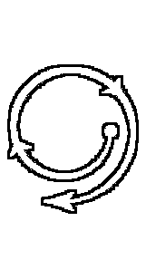</td>
    <td align="center"><b>Expelliarmus</b><br/></td>
    <td align="center"><b>Expulso</b><br/></td>
    <td align="center"><b>Finestra</b><br/></td>
  </tr>
  <tr>
    <td align="center"><b>Finite</b><br/></td>
    <td align="center"><b>Flagrate</b><br/></td>
    <td align="center"><b>Flipendo</b><br/>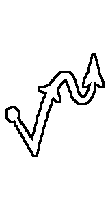</td>
    <td align="center"><b>Fulgari</b><br/></td>
  </tr>
  <tr>
    <td align="center"><b>Glacius</b><br/>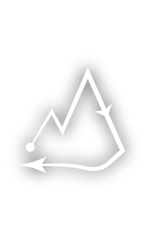</td>
    <td align="center"><b>Herbivicus</b><br/></td>
    <td align="center"><b>Immobulus</b><br/>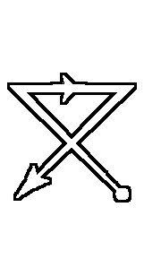</td>
    <td align="center"><b>Impedimenta</b><br/></td>
  </tr>
  <tr>
    <td align="center"><b>Incarcerous</b><br/></td>
    <td align="center"><b>Incendio</b><br/></td>
    <td align="center"><b>Lumos</b><br/></td>
    <td align="center"><b>Lumos Maxima</b><br/>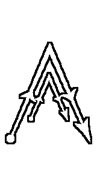</td>
  </tr>
  <tr>
    <td align="center"><b>Melefors</b><br/></td>
    <td align="center"><b>Meteolojinx</b><br/></td>
    <td align="center"><b>Mucus Ad Nauseum</b><br/></td>
    <td align="center"><b>Nox</b><br/></td>
  </tr>
  <tr>
    <td align="center"><b>Orchideous</b><br/></td>
    <td align="center"><b>Petrificus Totalus</b><br/>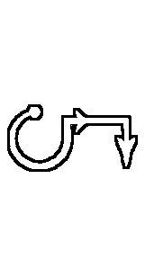</td>
    <td align="center"><b>Piertotum Locomotor</b><br/></td>
    <td align="center"><b>Protego</b><br/>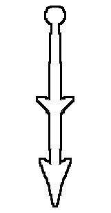</td>
  </tr>
  <tr>
    <td align="center"><b>Quietus</b><br/></td>
    <td align="center"><b>Reducto</b><br/></td>
    <td align="center"><b>Reparo</b><br/>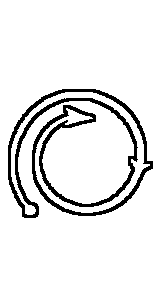</td>
    <td align="center"><b>Revelio</b><br/>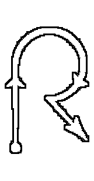</td>
  </tr>
  <tr>
    <td align="center"><b>Rictusempra</b><br/></td>
    <td align="center"><b>Riddikulus</b><br/>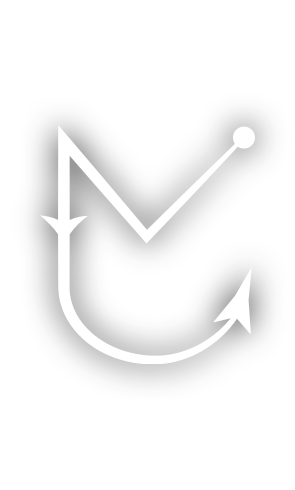</td>
    <td align="center"><b>Salvio Hexia</b><br/></td>
    <td align="center"><b>Scourgify</b><br/></td>
  </tr>
  <tr>
    <td align="center"><b>Silencio</b><br/></td>
    <td align="center"><b>Stupefy</b><br/>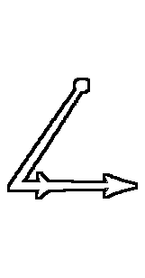</td>
    <td align="center"><b>The Cheering Charm</b><br/>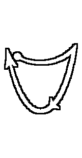</td>
    <td align="center"><b>The Force Spell</b><br/></td>
  </tr>
  <tr>
    <td align="center"><b>The Hair Thickening Growing Charm</b><br/></td>
    <td align="center"><b>The Hour Reversal Charm</b><br/></td>
    <td align="center"><b>The Sleeping Charm</b><br/></td>
    <td align="center"><b>The Spell Thickening Charm</b><br/></td>
  </tr>
  <tr>
    <td align="center"><b>The Stretching Jinx</b><br/></td>
    <td align="center"><b>Ventus</b><br/></td>
    <td align="center"><b>Verdimillious</b><br/></td>
    <td align="center"><b>Vermillious</b><br/></td>
  </tr>
  <tr>
    <td align="center"><b>Wingardium Leviosa</b><br/></td>
    <td></td>
    <td></td>
    <td></td>
  </tr>
</table>

## Automations and repeated casts

Use the actual Spell sensor and light entity IDs from your HA instance. A trigger on the `last_updated` attribute also catches two consecutive casts of the same spell. Triggering only on a change to `Lumos` would miss a second `Lumos` if the sensor already held that value.

Native spell names preserve the wand's case, while the server may return a lowercase name. The following example normalizes `Lumos`/`lumos` and `Nox`/`nox`. Paste it into a new automation's YAML editor and replace the example entity IDs:

```yaml
alias: Wand controls the light
triggers:
  - trigger: state
    entity_id: sensor.mcw_example_spell
    attribute: last_updated
conditions: []
actions:
  - choose:
      - conditions: "{{ trigger.to_state.state | lower == 'lumos' }}"
        sequence:
          - action: light.turn_on
            target:
              entity_id: light.example
      - conditions: "{{ trigger.to_state.state | lower == 'nox' }}"
        sequence:
          - action: light.turn_off
            target:
              entity_id: light.example
mode: queued
max: 5
```

**Spell Timeout** controls when the sensor resets to `awaiting`; the default `0` leaves the last spell until the next update. A nonzero timeout resets it after that many seconds. The automation above ignores `awaiting` because neither branch matches it. Repeated casts are handled without requiring a timeout.

## Spell Canvas

Spell Canvas is a camera entity showing the trajectory of a cast. It is separate from the basic built-in Spell sensor.


### Prepare the optional server path

The current **Spell Tracking** switch initializes the remote detector before starting IMU streaming. A reachable server and successful model initialization are required for this path; simply turning the switch on does not provide a server-free drawing mode.

1. Set up a compatible TFLite service. The original project used the [hass-tflite add-on](https://github.com/ificator/hass-tflite) and its **Open web UI** to upload `model.tflite`.
2. Supply a compatible `model.tflite`. **This repository does not publicly provide the model.** A generic TFLite model is not automatically compatible. If you do not have a compatible model, use built-in wand recognition instead.
3. In the integration's options, set **TFLite Server URL** to the reachable server address. See [setup](setup.md#integration-options) for the default value.
4. Turn **Connect** on, then turn **Spell Tracking** on. Confirm the tracking switch remains on; a server or IMU-start failure must be resolved before drawing will work.

Original server setup and recognition examples:

<table>
  <tr>
    <td colspan="2" align="center">
      
    </td>
  </tr>
  <tr>
    <td colspan="2" align="center">
      
    </td>
    <td colspan="2" align="center">
      
    </td>
    <td colspan="2" align="center">
      
    </td>
  </tr>
</table>


### Draw and recognize a cast

1. Open the wand's **Spell Canvas** camera entity, or add it to a dashboard camera card.
2. Press and hold all four grip/button sensors together. This begins a new cast; the configured casting LED lights while the grip is held.
3. Move the wand through the gesture while keeping all four pressed. The camera draws the recorded path.
4. Release at least one of the four sensors to finish. HA stops that cast and asks the remote detector to recognize it. A successful result updates the Spell sensor and triggers wand vibration feedback.

Releasing is the recognition step; moving the wand without the all-four grip does not start a tracked cast. Native wand spell notifications are still received while tracking is enabled. Check the actual Spell sensor rather than assuming that selecting Server mode suppresses the wand's own recognition.

Example dashboard card; replace the camera ID with the entity shown on your wand's device page:

```yaml
type: picture-entity
entity: camera.your_wand_spell_canvas
camera_view: live
show_name: true
show_state: false
```

If the wand disconnects during a cast, reconnect it and verify the actual Spell Tracking state before starting again. See [connection troubleshooting](troubleshooting.md).

## Available services

In **Developer tools → Actions**, select one of these actions and target an entity belonging to the connected wand or box. `play_spell` plays a wand/box effect; it does not simulate an incoming recognized spell or automatically run your light automation.

| Action | Use | Device limits |
|---|---|---|
| `magic_caster_wand.set_led` | Set the RGB color of a selected LED group; `duration: 0` keeps it on. | Wand: TIP, MID_UPPER, MID_LOWER, POMMEL. Box: TIP only. |
| `magic_caster_wand.clear_leds` | Clear the device LEDs. | Wand and box. |
| `magic_caster_wand.vibrate` | Trigger a vibration pulse. | Wand only; one command produces about 800 ms regardless of the requested duration. |
| `magic_caster_wand.play_spell` | Play a predefined LED/vibration spell effect such as `lumos` or `nox`. | Box has only one LED and no vibration. |
| `magic_caster_wand.send_macro` | Send ordered LED, delay, vibration and loop commands. | Box ignores vibration; use only TIP for box LED commands. |

Example: light the wand tip warm yellow. Replace the target with an entity registered to your wand, such as its Spell sensor:

```yaml
action: magic_caster_wand.set_led
target:
  entity_id: sensor.mcw_example_spell
data:
  group: tip
  rgb_color: [255, 220, 100]
  duration: 0
```

Example: play the built-in `lumos` effect from HA:

```yaml
action: magic_caster_wand.play_spell
target:
  entity_id: sensor.mcw_example_spell
data:
  spell: lumos
```

`send_macro` supports `changeled`, `clear`, `delay`, `buzz`, `set_loops`, `loop` and `wait`. The fields and limits for each command are documented in the action form and [services.yaml](../custom_components/magic_caster_wand/services.yaml). Closely spaced buzz packets can extend a vibration pulse, but one command's duration does not directly set its physical pulse length. Avoid overlapping macro sequences when checking a partial or failed effect.

## References

- [Magic-Caster-Wand-Open-app-ai (whymaxwhy)](https://github.com/whymaxwhy/Magic-Caster-Wand-Open-app-ai.git)
- [OpenCaster (Blues-Hailfire)](https://github.com/Blues-Hailfire/OpenCaster.git)
